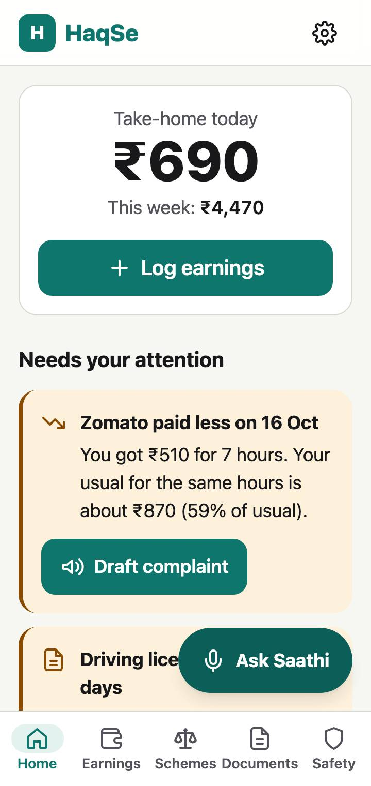

# HaqSe — Gig Worker Companion

**HaqSe** ("by right") is a local-first, installable web app that turns a gig worker's own work data into real earnings insight, matched welfare schemes, ready documents and ready-to-send complaints, in English, Hindi or Punjabi. It uses Google Gemini as its reasoning layer.

**Live:** https://haqse.programmersingh.dev



---

## Chosen vertical

**Gig and informal workers in India**: food-delivery riders, cab and bike-taxi drivers, domestic and construction workers.

Platforms hold the worker's earnings, deduction and deactivation data. The worker holds no evidence and has no simple path to the rights and schemes they qualify for. HaqSe gives them their own record and turns it into action. It is built for three personas: a delivery rider on two apps (Punjabi/Hinglish, cheap Android), a cab driver worried about documents and night safety (Hindi), and a daily-wage worker with no platform at all (voice-first, shared phone).

## Approach and logic

**One profile, one ledger, connected flows.** Every module reads from and writes to two local stores, the worker profile and the earnings ledger (IndexedDB). These are not six chat tabs. Each flow hands off to the next.

**Rules decide, Gemini explains.** Deterministic, unit-tested rules in `src/lib/rules/` decide _what_ is relevant. Gemini only turns that into plain language and drafts, grounded in bundled data. This keeps the core predictable, testable and safe from hallucination, and the whole app works without AI.

| Signal             | Rule (deterministic, tested)                                                  | What the app does                                        |
| ------------------ | ----------------------------------------------------------------------------- | -------------------------------------------------------- |
| Payout drop        | Day payout/hour < 75% of the 14-day median for that platform (≥ 3 prior days) | Anomaly card → pre-filled dispute draft                  |
| Low net earnings   | Net/hour below the user's target, else the state minimum-wage reference       | Cost-share and best-platform advice                      |
| Document expiry    | Expiry within 30 days, or already expired                                     | Home alert; **blocks "Apply"** on schemes that need it   |
| Scheme eligibility | Profile vs. each scheme's JSON rules (age band, state, work, income, platform) | Ranked Eligible / Likely / Need info, with reasons       |
| Shift context      | Local hour 21:00–05:00, or the user flags heat/rain                           | Night/heat/rain tips; SOS made prominent                 |
| Incomplete profile | A rule needs a field the profile lacks                                        | Asks **one** question in context, not a long form        |
| No key / offline   | Key missing or invalid, or `navigator.onLine` false                           | Local parser, templates and static content; never queues |

Before any AI call, a pure `buildContext()` builds a compact summary (≤ 1.5 KB JSON, no raw ledger, no names, notes or ID numbers).

## How the solution works

```
            ┌───────── Worker profile ─────────┐   ┌──────── Earnings ledger ────────┐
            │ language, state, work, vehicle,  │   │ date, platform, payout, tips,   │
            │ platforms, age band, income band │   │ fuel, costs, hours, trips       │
            └───────────────┬──────────────────┘   └───────────────┬─────────────────┘
                            └──────────── lib/rules (pure) ────────┘
                                             │
    ┌──────────┬───────────┬─────────────────┼─────────────┬────────────┬───────────────┐
  Kamai       Haq        Kagaz           Shikayat      Suraksha     Saathi (assistant)
 earnings   schemes &   documents &      complaints     SOS, tips,   on every screen,
 + anomaly   rights      expiry          (drafts)       incidents    function calling
    │           │           │               ▲              │
    └── flow 1 ─┼───────────┼───────────────┤              │
                └─ flow 2 ──┘               └──── flow 3 ──┘
```

**The three connected flows (demoable in under 2 minutes):**

1. **Log → Insight → Dispute.** Log a day by voice, text or payout screenshot. The ledger computes net per hour and flags the 59%-of-usual day. **Draft complaint** opens Shikayat pre-filled with the date, hours, amount paid and expected amount.
2. **Profile → Schemes → Documents.** The profile ranks 10 curated schemes. Each scheme lists its required papers. Missing or expiring ones show up in Kagaz first, and "Apply" stays blocked until they are fixed.
3. **Incident → Safety → Grievance.** SOS or "Report incident" logs time, place and notes. Suraksha shows next steps for that incident type. **Raise complaint** drafts a letter to the police, insurer, platform or labour department.

| Module   | Path        | What it does                                                                                                           |
| -------- | ----------- | ---------------------------------------------------------------------------------------------------------------------- |
| Kamai    | `/kamai`    | Voice/text/screenshot/manual logging with confirm-before-save; today, week, net/hour, cost share; 14-day chart; per-app table |
| Haq      | `/haq`      | Rule-ranked schemes with reasons, "Explain simply" grounded Q&A citing the official link, Know-your-rights cards       |
| Kagaz    | `/kagaz`    | Document checklist with expiry; photo scan (image kept in memory only, ID numbers scrubbed); form explainer            |
| Shikayat | `/shikayat` | Simple (your language) + formal (English) drafts; edit, copy, share, email, WhatsApp; draft → sent → resolved          |
| Suraksha | `/suraksha` | SOS (hold, or tap + confirm): 112, SMS with location to contacts, works offline; shift tips; incident log              |
| Saathi   | everywhere  | Assistant with Gemini function calling (`logEarning`, `openScheme`, `draftGrievance`, `addDocument`, `showSafetyTips`); every action needs a tap to confirm; local fallback |

**BYOK (bring your own key).** You paste a Gemini key. It is checked with a real `models.list` call, and the app then lists the Flash models that key can use (cached 24 h; bundled fallback `gemini-3.8-flash` → `gemini-3.6-flash` → `gemini-3.5-flash-lite`). The key is stored only in IndexedDB and sent only to `generativelanguage.googleapis.com`. All provider code sits in `src/lib/ai/client.ts`, so a sponsor-held proxy would change one file.

**Gemini usage:** stateless `generateContent` only; `responseJsonSchema` from Zod and re-validation with Zod on every structured answer; `thinkingLevel` (`low`/`medium`) and no sampling parameters; one jittered retry on 429/5xx; automatic fall-through when a model is retired; `AbortController` on screen exit; a 24 h response cache for explanations and a per-week cache for summaries.

## Install and updates (PWA)

HaqSe installs like an app from any modern browser, and the app shows the right way for the browser the worker is using. Detection is in `src/lib/pwa/platform.ts`, tested against 15 real user agents.

| Browser                                | How HaqSe helps you install                                                         |
| -------------------------------------- | ----------------------------------------------------------------------------------- |
| Chrome, Edge, Opera, Samsung (Android/desktop) | One-tap **Install app** button (native `beforeinstallprompt`)               |
| Same browsers before the prompt is ready | Steps: menu ⋮ → "Install app" / "Add to Home screen"                            |
| Safari, Chrome, Firefox or Edge on iPhone/iPad | Steps with pictures: Share → "Add to Home Screen" → Add                     |
| Samsung Internet                       | Steps: menu ≡ → "Add page to" → "Home screen"                                       |
| Firefox on Android                     | Steps: menu ⋮ → "Install"                                                           |
| Safari on Mac                          | Steps: File → "Add to Dock"                                                         |
| WhatsApp / Instagram / Facebook browser | "Open in your browser first", with a copy-link button                              |
| Firefox on a computer                  | Explains it can't install; suggests Chrome or Edge; the website keeps working       |

- **Where:** a dismissible suggestion on Home from the second visit (back after 3 days if dismissed, never once installed), a step in onboarding, and **Settings → App**.
- **App manifest:** it includes `id`, a maskable icon, screenshots for Chrome's richer install sheet, and shortcuts (**Log earnings**, **SOS**, **Complaints**) for long-pressing the app icon.
- **Updates:** a new deploy never interrupts the worker. The open app checks hourly and whenever it is brought back to the screen. When a new version is ready, a bar appears at the top with **Update now** and **Later**. **Settings → App** shows the version and commit, plus **Check for updates**. Your data lives in IndexedDB, so it is kept across updates. On iPhone, close and reopen the app after updating.
- **Offline:** the app shell and data files are precached. The app opens and every non-AI feature works with no connection.

## Assumptions

1. Workers use an Android phone with a modern Chromium browser and patchy internet.
2. Evaluators bring their own Gemini key. A real deployment would put an NGO-, union- or cooperative-held key behind a thin proxy.
3. Scheme and rights data is a curated sample (10 schemes: central plus Punjab, Rajasthan and Karnataka examples), dated `verifiedOn` in the app. It is not exhaustive and **not legal advice**; spot-check against official portals.
4. Workers can read numbers and recognise icons even if reading text is hard.
5. Earnings are entered by the worker. There is no platform API access.
6. Minimum-wage and threshold values are configurable reference constants (`src/lib/constants.ts`), not authoritative legal figures.

## Getting started

```bash
npm ci
npm run dev          # http://localhost:5173
```

1. Pick a language, answer up to five tap questions (all skippable).
2. Optionally paste a free Gemini key from https://aistudio.google.com/apikey.
3. Tap **Try with demo data** to load 14 days of earnings with one payout drop, a licence expiring in 20 days and one night incident.

| Command                   | What it does                                                              |
| ------------------------- | ------------------------------------------------------------------------- |
| `npm run build`           | Type-check and build to `dist/` (CSP meta, PWA, `404.html` SPA fallback)  |
| `npm run preview`         | Serve the production build                                                |
| `npm test`                | Unit, component and AI-contract tests (Vitest)                            |
| `npm run test:coverage`   | Same, with coverage gates on `src/lib` and `src/features/*/logic`         |
| `npm run test:e2e`        | Playwright on a 360 px Android viewport: all three flows plus an axe scan |
| `npm run lint` / `format` | oxlint (zero warnings) / Prettier                                         |
| `npm run typecheck`       | `tsc -b` across app, config and e2e projects                              |
| `npm run size`            | Fails if initial JS is over 200 KB gzipped                                |

Deployment: every push to `main` runs all checks in GitHub Actions and publishes `dist/` to GitHub Pages (no `gh-pages` branch). Set the repository variable `VITE_BASE` to `/<repo>/` while on `<user>.github.io`, or leave it unset for the custom domain (`public/CNAME`).

## Security, accessibility, efficiency and testing

**Security**

- No secrets in the repo (`.env*` ignored; `.env.example` only). The key lives only in IndexedDB, is masked in the UI, is never logged and is excluded from the data export.
- CSP meta tag: `default-src 'self'`, `script-src 'self'`, `connect-src 'self' https://generativelanguage.googleapis.com`, no inline scripts. (The e2e axe test has to bypass it, which shows it is enforced.)
- AI output is rendered only as React text nodes. There is no `dangerouslySetInnerHTML` (lint error `react/no-danger`).
- Prompt-injection guard: user, document and screenshot text is wrapped as data. Every structured reply is Zod-validated, and tool calls are validated and need a user tap.
- Privacy: document photos are downscaled in a canvas and never stored. ID, account and PAN-shaped numbers are scrubbed from AI output, and no ID numbers are ever saved. One tap deletes everything.
- `npm audit --audit-level=high` runs in CI (currently 0 vulnerabilities).

**Accessibility (WCAG 2.2 AA)**

- axe-core in Playwright reports **zero violations on every page, in light and dark themes**. Component tests run axe in jsdom too.
- Semantic HTML first: native `<dialog>` sheets, real radio/checkbox chips, ARIA tabs with arrow keys, a `role="switch"` with `aria-checked`, a skip link, one `h1` per screen, and `lang` on mixed-language blocks.
- 18 px base text, 48 px tap targets, a 3 px focus ring, status shown with icon and text (never colour alone), and a data-table alternative for the chart.
- `prefers-reduced-motion` and `prefers-color-scheme` are respected. Audio never autoplays, and every AI answer has **Read aloud**. Every text field accepts voice dictation.
- SOS has a tap-and-confirm alternative to the long-press gesture (WCAG 2.5.1). No horizontal scroll at 360 px (checked in e2e).

**Efficiency**

- **Initial JS ≈ 164 KB gzipped** (budget 200 KB, enforced by `npm run size`). The Gemini SDK (~70 KB gz) loads only on the first AI call.
- Every screen, every locale and all curated JSON are separate lazy chunks. Devanagari and Gurmukhi fonts are subset, self-hosted and loaded only for that language.
- Ledger aggregates are single-pass O(n). Dexie range queries use the `date` index (no full scans). The React Compiler handles memoisation.
- Workbox precaches the app shell for offline use and serves Gemini network-only. Images are capped at 1024 px JPEG 0.7 before upload.

**Testing**

- 100+ Vitest tests: the rules (all PRD §10 example cases), `buildContext` (size cap with 100 entries, no PII), the local parser (Roman Hindi, Devanagari and Gurmukhi digits), the DB and demo seed, and AI contracts with a mocked SDK (valid JSON accepted, malformed rejected, 429 retry, abort, model fall-through, bad key, no sampling parameters).
- A translation test fails if any key is missing, or if Hindi or Punjabi drift from English in keys or `{{placeholders}}`.
- Bundled data is validated against the same Zod schemas the app uses.
- Playwright: flow 1 (anomaly → draft → copy), flow 2 (scheme → missing paper → apply unlocked), flow 3 (incident → steps → police draft), typed earnings, Saathi without a key (the two PRD acceptance phrases), language switch, offline SOS, and axe on all pages.

**Manual checklist before each attempt:** TalkBack pass, keyboard-only pass, offline mode, no-key mode, Hindi and Punjabi, Lighthouse on the live URL (Performance 90+, Accessibility 100, installable), real key → model list and live parse/draft.

## Limitations and future work

- Hindi and Punjabi strings were written for this build and **need a native-speaker review**.
- Scheme rules use age and income _bands_, so borderline cases show "Likely" rather than a hard yes/no.
- Voice capture on browsers without `MediaRecorder` falls back to on-device dictation, whose quality varies by device.
- Not yet built (P1/P2): optional app lock (WebAuthn/PIN), sponsor-key proxy and QR provisioning, more states' schemes, and a scheduled document-expiry notification.

## License

MIT. See [LICENSE](LICENSE).
